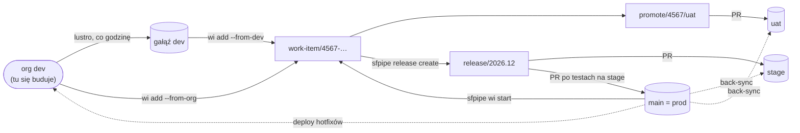
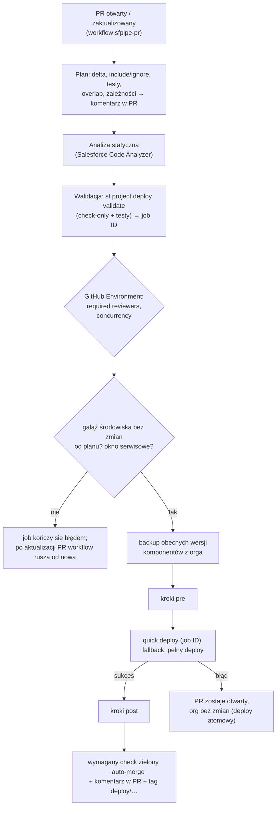

# Custom Salesforce Deployment Pipeline — plan funkcjonalności

> Status: propozycja do akceptacji · v4 · 2026-11-23
>
> **Wersja uproszczona (2026-11-23):** zamiast CLI `sfpipe` zestaw `kit/`: workflowy `sf-deploy`, `sf-promote`, `sf-release`, `sf-back-sync` i skrypty kopiowane do repo `salesforce`. Ten sam model gałęzi (§4) i deploy-then-merge (§9); bez lustra dev, overlapu i rollbacku w pierwszej wersji. Opis: `kit/README.md`.
>
> **Zmiany w v4:** dopasowanie do repo w układzie harnessu (§16): User Story w Azure Boards linkowane przez `AB#<id>` zamiast GitHub Issues, gałęzie `work-item/<id>-<opis>` i `feature/<id>-<opis>`, manifest US w `work-items/<id>-<opis>/sfpipe.yml`, tematy commitów zgodne z hookiem harnessu, CI narzędzia także na Windows.
>
> v3: całość na GitHubie zamiast Azure DevOps: repo zostaje tam, gdzie jest (bez migracji), CI to GitHub Actions, akceptacje i sekrety w GitHub Environments, User Story jako GitHub Issues + Projects (§11).
>
> Wcześniej: v2 dev jako źródło zmian z lustrem w gicie, stage i prod jako release candidate; v2.1 dev to Full Copy, lustro bez source trackingu; v2.2 kod lokalnie w VS Code z ochroną przed nadpisaniem w dev, akceptacje: developer na uat i stage, Product Owner na prod.

## 1. Streszczenie

Pipeline oparty na **gałęziach work-itemów** (1 User Story w Azure Boards = 1 gałąź) dla czterech środowisk: `dev → uat → stage → prod`. Do każdego środowiska trafia tylko to, co wybierzesz: na poziomie całych US i na poziomie pojedynczych komponentów.

Kluczowe decyzje projektowe:

1. **Dev to miejsce pracy i źródło zmian.** Gałąź `dev` jest automatycznym lustrem orga dev, więc wszystko, co się tam dzieje, widać w gicie (co, kto, kiedy), także zmiany jeszcze nieprzypisane do żadnego US.
2. **Gałąź US zawsze od `main` (= prod).** Paczkę US składa się cherry-pickiem komponentów z dev (z lustra albo prosto z orga) lub z kodu pisanego lokalnie.
3. **UAT: promocja pojedynczych US.** Każdy US wchodzi do UAT niezależnie, przez krótkotrwałą gałąź promocyjną. Nigdy nie mergujemy środowiska w środowisko.
4. **Stage i prod: release candidate.** Jedna gałąź `release/…` z wybranymi US jest testowana na stage, a potem ta sama gałąź idzie na prod. Stage testuje dokładnie to, co trafi na produkcję.
5. **Paczka = git.** Zawartość paczki to delta gita (sfdx-git-delta). Dodanie lub odjęcie komponentu to commit na gałęzi US, więc paczka, gałąź i org nie mogą się rozjechać.
6. **Deploy-then-merge w GitHub Actions.** Workflow PR ma job deployu za akceptacją w GitHub Environment; PR merguje się automatycznie (auto-merge) dopiero, gdy deploy się powiedzie.
7. **Stan wyliczany z gita i widoczny w PR-ach.** Bez osobnej bazy danych: „US AB#4567 jest w UAT” = commit US jest osiągalny z gałęzi `uat`.
8. **Narzędzie = CLI `sfpipe` (TypeScript) + reużywalne workflowy GitHub Actions.** Ta sama komenda działa lokalnie i w pipeline.

## 2. Zakres

**W zakresie**
- lustro orga dev w gicie i raport zmian nieprzypisanych do US,
- cykl życia US od utworzenia gałęzi do produkcji, powiązany z Azure Boards przez `AB#<id>`,
- cherry-pick na poziomie US (które US idą do UAT i do release'u) i komponentów (dodaj / usuń / przenieś komponent w paczce),
- walidacja, testy, deploy, destructive changes, kroki pre/post, wartości zależne od środowiska,
- release (stage → prod), hotfix, back-sync, rollback, wykrywanie driftu w uat/stage/prod.

**Poza zakresem (na teraz)**
- unlocked / 2GP packages (zakładamy org-based development w formacie source),
- migracja danych (poza prostymi skryptami post-deploy),
- własny UI (rolę UI pełnią Azure Boards, PR-y i Environments),
- zmiana stanu work itemów w ADO (zostaje decyzją człowieka, jak w procesie harnessu).

**Założenia** (potwierdzone, patrz §15)
- GitHub: repo, Actions, Environments; User Story w Azure Boards, połączone z GitHubem aplikacją Azure Boards,
- zespół buduje konfigurację kliknięciami we wspólnym sandboxie `dev`, a kod lokalnie w VS Code na gałęziach US,
- 4 orgi: `dev` (full copy), `uat` (partial copy), `stage` (full copy, próba generalna produkcji), `prod`,
- istniejące repo z metadanymi Salesforce na GitHubie (format source, `sfdx-project.json`); deploy przez Metadata API (`sf project deploy …`).

## 3. Słownik

| Pojęcie | Znaczenie |
|---|---|
| **Work item (WI) / US** | User Story lub Bug w Azure Boards, identyfikowany numerem, np. `AB#4567`. Jedna gałąź `work-item/4567-<opis>`. |
| **Feature** | Kilka US dostarczanych razem na jednej gałęzi `feature/<id>-<opis>`; promowane jako jedna paczka. |
| **Komponent** | Element metadanych w postaci `Typ:Nazwa`, np. `ApexClass:DiscountService`, `CustomField:Opportunity.Discount__c`. |
| **Paczka** | Zbiór komponentów, które wdrożenie US zmienia w danym środowisku (łącznie z usunięciami). |
| **Lustro dev** | Gałąź `dev` aktualizowana automatycznie stanem orga dev; każdy commit = zmiany jednej osoby. |
| **Środowisko** | Para org + gałąź: `dev`/`dev` (lustro), `uat`/`uat`, `stage`/`stage`, `prod`/`main`. |
| **Promocja** | Przeniesienie US do UAT przez gałąź `promote/…` i PR. |
| **Release candidate** | Gałąź `release/<nazwa>` = `main` + wybrane US; wdrażana na stage, a potem bez zmian na prod. |
| **Back-sync** | Przeniesienie zmian z `main` (np. hotfixa) z powrotem do `stage`, `uat` i do orga dev. |
| **Sieroty** | Zmiany w dev, których nie ma na prod ani w żadnym otwartym US. |

## 4. Model gałęzi



| Gałąź | Rola | Kto pisze |
|---|---|---|
| `main` | stan produkcji | tylko pipeline (merge po udanym deployu release'u lub hotfixa) |
| `stage`, `uat` | stan danego orga | tylko pipeline (merge po udanym deployu) |
| `dev` | lustro orga dev: snapshot + historia zmian | tylko workflow lustra; **nigdy nie jest mergowana dalej** |
| `work-item/4567-*` | praca nad US, źródło paczki | deweloperzy + `sfpipe wi add/remove` |
| `promote/4567/uat` | jednorazowa: `uat` + merge US; tu rozwiązuje się konflikty | `sfpipe promote` |
| `release/<nazwa>` | `main` + merge wybranych US; release candidate dla stage i prod | `sfpipe release` |
| `hotfix/<ID>` | pilna poprawka od `main` | deweloperzy |

**Dlaczego gałąź promocyjna**, a nie merge `work-item/4567` prosto do `uat`:
- konflikty z innymi US rozwiązuje się w kontekście UAT, a gałąź US zostaje czysta (bazuje na `main`). Da się ją potem włączyć do release'u bez śmieci z `uat`;
- delta do wdrożenia jest dokładnie policzalna: `diff(uat, promote/4567/uat)`.

**Dlaczego gałąź `dev` nie jest celem promocji.** W dev się buduje, więc org dev zawsze wyprzedza gita. Reguła „gałąź = to, co wdrożone” nie może tam działać. Dlatego kierunek jest odwrotny: org → gałąź (lustro), a gałąź `dev` służy do obserwacji i jako źródło cherry-picka.

**Reguły spójności**
- **Back-sync po każdym deployu na prod.** Workflow otwiera PR-y `main → stage` i `main → uat` (wdrażają tylko hotfixy, bo reszta już tam jest) i wdraża hotfixy do orga dev. Dzięki temu każda gałąź środowiska zawiera całe `main`.
- **Na stage jest tylko `main` + bieżący release candidate.** Merge release'u do stage jest wtedy czysty, a anulowany release jest cofany revertem.
- **Kolejność jest wymuszana**: do release'u wchodzą tylko US, które są w `uat` w tym samym commicie.
- **Tylko merge commit na gałęziach środowisk.** Squash i rebase są zablokowane rulesetem: zniszczyłyby historię, z której liczony jest status US, i powodowały powtarzające się konflikty.
- **Konwencja commitów.** Tematy jak w hooku harnessu: `[WI-4567] … — AB#4567` na gałęzi US, `[FEATURE-<id>] … — AB#<id>` na gałęzi Feature, `[chore] …` bez work itemu (lustro, back-sync, baseline). Szablony są w configu (`commits`). `AB#` linkuje commit z US w Azure Boards. Commity narzędzia mają dodatkowo trailery `Work-Item: 4567` i `Sfpipe-Action: …`; dotyczy to także merge commitów robionych lokalnie (`promote`, `release`), bo hook sprawdza je tak samo.

## 5. Dev jako źródło: lustro orga w gicie

Dev to sandbox **Full Copy**, a Salesforce udostępnia source tracking tylko w sandboxach Developer i Developer Pro. Lustro działa więc w dwóch trybach.

**Przyrostowo, co godzinę w godzinach pracy** (`sfpipe ci dev-mirror`, workflow z harmonogramem, plus ręczne uruchomienie):

1. `listMetadata` dla każdego śledzonego typu zwraca wszystkie komponenty z datą i autorem ostatniej zmiany (`lastModifiedDate`, `lastModifiedByName`).
2. Porównanie z listą z poprzedniego przebiegu daje komponenty nowe, zmienione i usunięte.
3. Retrieve tylko zmienionych komponentów i zapis do gałęzi `dev`: **jeden commit na osobę**, z autorem = ta osoba (mapowanie użytkownik Salesforce → e-mail w configu), np. `dev: Opportunity layout, DiscountService (3 komponenty)`.
4. Stan (listy komponentów z datami) zapamiętany w `.sfpipe/state/dev-mirror.json` na gałęzi `dev`.

**Pełne uzgodnienie, co noc** (`sfpipe ci dev-mirror --full`): retrieve wszystkich śledzonych typów według `package.xml` i porównanie z gałęzią. Łapie to, czego tryb przyrostowy nie widzi: typy, które nie raportują dat rzetelnie (np. część `Settings`, tłumaczenia), i zmiany wewnątrz plików zbiorczych. Autor pochodzi z `lastModifiedByName`, jeśli typ go podaje; w przeciwnym razie commit jest oznaczony jako „autor nieustalony”.

Opcjonalnie raport korzysta z Setup Audit Trail (kto i co zmienił w Setup), żeby pokazać też zmiany spoza metadanych, np. uprawnienia użytkowników.

Względem source trackingu tracimy niewiele: część zmian pojawia się w gicie z opóźnieniem do jednej nocy, a przy kilku zmianach tego samego komponentu w ciągu godziny autorem commitu jest ostatnia osoba.

**Co to daje**
- `git log dev` = historia wszystkiego, co działo się w dev, z autorami,
- `git diff main dev` = wszystko, co jest w dev, a nie ma na prod,
- `sfpipe dev orphans` = zmiany w dev, których nie ma ani na prod, ani w żadnym otwartym US. Nic nie ginie po drodze i nic nie wchodzi przypadkiem. Raport może iść cyklicznie na Teams/Slack albo jako komentarz w PR,
- `sfpipe wi add --from-dev` = cherry-pick do US prosto z lustra, bez dostępu do orga.

**Deploy do dev** zostaje, ale tylko w dwóch przypadkach i bez PR-ów: hotfixy z `main` oraz kod pisany lokalnie (§5.1). Lustro i tak zarejestruje wynik.

**Refresh sandboxa dev**: po odświeżeniu z prod lustro zaczyna od nowej linii bazowej (gałąź `dev` ustawiana na stan orga).

**Ograniczenie wspólnego orga.** Jeden plik w dev może zawierać zmiany dwóch US naraz (ten sam layout, ta sama klasa). Git nie rozdzieli jednego pliku na dwa US. `wi add` ostrzega, gdy komponent zmieniało w dev kilka osób od ostatniego release'u albo gdy jest już w innym otwartym US. Zasada zespołu: jeden komponent = jeden otwarty US naraz; większe zmiany w kodzie robi się lokalnie na gałęzi US albo w osobnym sandboxie.

### 5.1 Kod pisany lokalnie w VS Code

Deweloper pracuje na gałęzi US i commituje normalnie. Do testów w dev wdraża przez:

```bash
sfpipe wi deploy 4567 --to dev
```

Wspólny dev ma jedną pułapkę: zwykły deploy z VS Code nadpisuje wszystko, co inna osoba zmieniła w tym samym komponencie. Dlatego `wi deploy` przed wdrożeniem pobiera z dev aktualne wersje komponentów US i dla każdego porównuje trzy wersje: bazową (z `main`, od której wyszedł US), z gałęzi US i obecną w dev.

| Sytuacja w dev | Co się dzieje |
|---|---|
| brak cudzych zmian | wdraża wersję z gałęzi US |
| cudze zmiany, które łączą się bez konfliktu | wdraża wersję połączoną; gałąź US dalej zawiera tylko własne zmiany |
| konflikt | zatrzymuje się, pokazuje diff i autora zmiany w dev; `--force` nadpisuje świadomie |

Deploy prosto z rozszerzenia Salesforce w VS Code dalej działa, ale bez tej ochrony. Dlatego repo dostaje zadania VS Code (`.vscode/tasks.json`) dla `wi deploy`, `wi add` i `wi show`.

Typowy US łączy oba sposoby pracy: kod commitowany lokalnie i konfigurację dobraną z dev przez `wi add --from-dev`, wszystko na jednej gałęzi US.

## 6. Cykl życia US

Status US w każdym środowisku jest wyliczany z gita:

| Symbol | dev | uat / stage / prod |
|---|---|---|
| `—` | brak zmian US w dev | US nie ma w środowisku |
| `✅` | komponenty US w gałęzi US = stan w lustrze dev | HEAD gałęzi US jest osiągalny z gałęzi środowiska |
| `⚠` | w dev są nowsze zmiany komponentów US (trzeba dobrać) albo kod US nie jest wdrożony do dev | US był wdrożony, ale gałąź US ma nowsze commity; trzeba wdrożyć ponownie |
| `↩` | — | był, ale został wycofany |

`sfpipe status`:

```
WI     Tytuł                       dev   uat   stage  prod
4567   Rabat na Opportunity        ✅    ✅    ✅     —
4570   Nowy layout Account         ⚠     ✅    —      —
4581   Integracja z ERP            ✅    —     —      —
```

**Przepływ krok po kroku**

1. **Start**: `sfpipe wi start 4567`
   - bierze tytuł z `work-items/4567-*/ado-context.md` (zapisuje go `/fetch-ado-item` w harnessie) albo z `--title`,
   - tworzy `work-item/4567-rabat-na-opportunity` od `origin/main`,
   - tworzy manifest `sfpipe.yml` w istniejącym folderze `work-items/4567-*/` (folder jest stały po ID, więc opis gałęzi może się różnić od nazwy folderu); dwa foldery dla jednego ID zatrzymują komendę.
2. **Praca**: kod lokalnie w VS Code na gałęzi US (commit + `sfpipe wi deploy 4567 --to dev` do testów), konfiguracja kliknięciami w orgu dev.
3. **Składanie paczki**: `sfpipe wi add 4567 --from-dev` pokazuje listę komponentów zmienionych w dev (autor, data, czy są już w innym US); wybierasz, co należy do tego US.
4. **Podgląd**: `sfpipe wi show 4567 --env uat` pokazuje komponenty, usunięcia, testy i ostrzeżenia.
5. **Promocja do UAT**: `sfpipe promote 4567 --to uat`
   - tworzy `promote/4567/uat` z `uat`, merguje US, pushuje, otwiera PR z `AB#4567` w opisie i włącza auto-merge,
   - workflow: plan → walidacja → akceptacja w Environment → deploy → merge (§9),
   - PR dostaje komentarz z listą komponentów i wynikiem deployu.
6. **Poprawki po UAT**: zmiana w dev, potem `sfpipe wi add 4567 --from-dev` (narzędzie pokazuje, które komponenty US zmieniły się w dev od ostatniego dobrania), ponowna promocja. Wdraża się tylko to, co się zmieniło.
7. **Release**: `sfpipe release create 2026.12 4567 4581` (albo `--query <id zapisanego zapytania ADO>`, np. `ado.releaseQueryId` z harnessu)
   - tworzy `release/2026.12` od `main` i merguje wybrane US,
   - PR do `stage` → deploy → testy regresji na stage,
   - PR tej samej gałęzi do `main` → deploy w oknie serwisowym → merge → back-sync.
8. **Zamknięcie**: gałąź US jest usuwana po wejściu na prod; stan US w Azure Boards zmienia człowiek; manifest zostaje w historii `main` jako ślad audytowy.

**Porzucenie US**: `sfpipe wi abandon 4567` otwiera PR-y wycofujące (revert) w środowiskach, w których US jest, i pokazuje komponenty, które trzeba ręcznie cofnąć w dev.

## 7. Paczka i cherry-picking

### 7.1 Co jest w paczce

```
paczka(US, env) = delta(gałąź env → gałąź promocyjna/release)   # sfdx-git-delta
                + include z manifestu US                           # wymuszone, choć plik się nie zmienił
                − ignore środowiska                                # np. komponenty nigdy nie idące na prod
```

Delta to dokładnie to, co zmieni się w gałęzi środowiska po merge'u, łącznie z rozwiązaniami konfliktów. Usunięte pliki trafiają do `destructiveChanges` (domyślnie post). Podgląd dla dowolnego środowiska (`wi show --env`) liczony jest bez checkoutu, przez `git merge-tree --write-tree`.

### 7.2 Manifest US

```yaml
# work-items/4567-rabat-na-opportunity/sfpipe.yml
id: 4567
title: Rabat na Opportunity          # z ado-context.md lub --title
dependsOn: [4560]                    # nie wejdzie do środowiska, w którym nie ma 4560
include:                             # wdrażaj, nawet jeśli plik się nie zmienił
  - "Layout:Opportunity-Opportunity Layout"
tests:                               # dokładane do testów wykrytych automatycznie
  - DiscountServiceTest
destructive:
  timing: post                       # pre | post
  confirmProd: true                  # usunięcia na prod wymagają osobnego potwierdzenia
steps:
  pre:
    - apex: scripts/4567/pre.apex
      envs: [uat, stage, prod]
  post:
    - apex: scripts/4567/assign-permsets.apex
    - manual: "Aktywuj flow Discount_Approval"   # checklista w PR, blokuje merge do odhaczenia
```

Manifest jedzie razem z gałęzią US i po promocji ląduje w gałęzi środowiska, więc każda gałąź środowiska „wie”, jakie US zawiera. Jeden plik na US oznacza brak konfliktów na manifestach.

### 7.3 Cherry-pick na poziomie US

Każdy US wchodzi do UAT niezależnie, a do release'u wybierasz dowolny podzbiór US z UAT (z zachowaniem `dependsOn`):

```bash
sfpipe promote 4570 --to uat                 # 4567 i 4581 nie są potrzebne
sfpipe release create 2026.12 4567 4581      # 4570 zostaje w uat na następny release
```

### 7.4 Cherry-pick na poziomie komponentów

Dodanie lub odjęcie komponentu to commit na gałęzi US (z trailerem `Sfpipe-Action`). Paczka liczona jest z gita, więc nie istnieje osobna lista, która mogłaby rozjechać się z kodem.

| Komenda | Co robi pod spodem |
|---|---|
| `sfpipe wi add 4567 --from-dev` | interaktywna lista zmian w lustrze dev (autor, data, przypisanie do innych US) do wybrania |
| `sfpipe wi add 4567 ApexClass:Foo --from-dev` | `git checkout dev -- <pliki komponentu>` + commit |
| `sfpipe wi add 4567 ApexClass:Foo --from-org dev` | `sf project retrieve start -m ApexClass:Foo -o dev` (stan na żywo) + commit |
| `sfpipe wi add 4567 CustomField:Account.X__c --from-wi 4570` | `git checkout <gałąź 4570> -- <pliki komponentu>` + commit |
| `sfpipe wi remove 4567 "Layout:Account-Account Layout"` | przywraca pliki do wersji z punktu bazowego (merge-base z `main`); nowe komponenty usuwa; commit |
| `sfpipe wi move CustomField:Account.X__c --from 4567 --to 4570` | `remove` w jednym US + `add --from-wi` w drugim |
| `sfpipe wi include 4567 <komponent> [--remove]` | dopisuje / usuwa wpis `include` w manifeście (redeploy bez zmiany pliku) |
| `sfpipe wi deploy 4567 --to dev` | deploy kodu z gałęzi US do dev z ochroną przed nadpisaniem cudzych zmian (§5.1) |
| `sfpipe dev orphans` | zmiany w dev bez US i bez prod |

Mapowanie komponent ↔ pliki robi biblioteka `@salesforce/source-deploy-retrieve`, ta sama, której używa `sf` CLI. Obsługuje typy rozbite na wiele plików (obiekty, pola, record types), bundle (LWC, Aura) i static resources.

**Usunięcie komponentu po promocji.** Jeśli komponent jest już w UAT, ponowna promocja wdroży cofnięcie: wersję bazową, a dla nowego komponentu usunięcie z orga. `wi remove` pokazuje to ostrzeżenie i proponuje `wi move`, gdy komponent ma po prostu należeć do innego US.

### 7.5 Nakładanie się US (overlap) i zależności

Przed każdą promocją i przy tworzeniu release'u `sfpipe` sprawdza:

- **Zależności**: `dependsOn` z manifestu oraz automatycznie, gdy gałąź US zawiera commity innego US. Blokada, jeśli zależności nie ma w środowisku docelowym i nie jest w tym samym release'ie.
- **Overlap**: inne US zmieniające te same komponenty i ich status. Przykładowe ostrzeżenie w PR:

  > ⚠ `ApexClass:DiscountService` zmienia też AB#4570 (uat ✅, release —). W UAT testowano wersję łączną; w release 2026.12 jest tylko zmiana z AB#4567.

- **Ryzykowne typy**: `Profile`, `Translations`, `Settings`, całe `CustomObject` dają ostrzeżenie; na prod opcjonalnie blokadę bez jawnej flagi.

## 8. Konfiguracja

```yaml
# .sfpipe/config.yml
workItem:
  provider: azure-boards              # albo github-issues (+ label)
  organization: contoso               # opcjonalnie: linki do ADO w PR
  project: Salesforce
  branchPrefix: work-item/
  featurePrefix: feature/
  manifest: "work-items/{id}-{slug}/sfpipe.yml"
commits:                              # domyślne dla azure-boards
  workItem: "[WI-{id}] {message} — AB#{id}"
  feature: "[FEATURE-{id}] {message} — AB#{id}"
  maintenance: "[chore] {message}"
baseBranch: main
environments:
  dev:
    role: source                      # lustro, bez PR-ów
    branch: dev
    org: sf-dev                       # alias sf CLI; GitHub Environment o tej samej nazwie
    mirror:
      incremental: "0 6-16 * * 1-5"   # cron w UTC: co godzinę w godzinach pracy
      full: "0 1 * * *"               # cron w UTC: pełne uzgodnienie w nocy
      types: [ApexClass, ApexTrigger, LightningComponentBundle, CustomObject,
              Flow, Layout, FlexiPage, PermissionSet, CustomLabels]
    users:                            # autorzy commitów lustra
      jan.kowalski@firma.pl.dev: jan.kowalski@firma.pl
  uat:
    branch: uat
    org: sf-uat
    promotion: work-item              # pojedyncze US przez promote/…
    testLevel: RunSpecifiedTests      # testy z US; fallback RunLocalTests
  stage:
    branch: stage
    org: sf-stage
    promotion: release
    testLevel: RunLocalTests
  prod:
    branch: main
    org: sf-prod
    promotion: release
    testLevel: RunLocalTests
    deployWindow: "Tue,Thu 18:00-21:00 Europe/Warsaw"   # sprawdzane przez sfpipe przed deployem
    ignore:
      - ApexClass:DebugUtils
tests:
  naming: ["{name}Test", "{name}_Test"]   # automatyczne wykrywanie klas testowych
```

Akceptacje i sekrety są w GitHub Environments (§11), nie w configu.

**Wartości zależne od środowiska** (URL-e Named Credentials, adresy e-mail w alertach itp.) obsługują natywne `replacements` w `sfdx-project.json` (`replaceWithEnv`), z wartościami ze zmiennych danego GitHub Environment. Żadnych wartości środowiskowych w repo.

## 9. Silnik wdrożeń

Każdy PR do `uat`, `stage` lub `main` (promote, release, back-sync, hotfix, revert) uruchamia workflow `sfpipe-pr`:



**Akceptacje**

| Środowisko | Review PR | Approval w Environment („wdrażamy teraz”) |
|---|---|---|
| uat | inny developer; jedyne code review w cyklu US | developer, może być autor |
| stage | niewymagane, bo zawartość przeszła review przy UAT | developer |
| prod | niewymagane | Product Owner, w oknie serwisowym |

Approval w Environment jest potrzebny także na UAT: workflow startuje od razu po otwarciu PR, więc bez tej bramki deploy poszedłby przed review. Ta sama osoba może zrobić review i zatwierdzić deploy.

- **Plan jako komentarz w PR**: komponenty (dodane / zmienione / usunięte), testy, ostrzeżenia, wynik walidacji, link do deploymentu w Setup.
- **Testy**: test level z konfiguracji środowiska. Dla `RunSpecifiedTests` lista = manifest + automatyczne wykrycie (`FooTest` dla zmienionej klasy `Foo`, testy triggerów). Przy `RunSpecifiedTests` każda wdrażana klasa i trigger musi mieć co najmniej 75% pokrycia z wybranych testów.
- **Quick deploy** wymaga walidacji z testami i jest ważny 10 dni. Jeśli wygasł albo paczka się zmieniła, walidacja idzie od nowa.
- **Aktualność**: ruleset wymaga, żeby PR był aktualny względem gałęzi środowiska („require branches to be up to date”). Job deployu dodatkowo sprawdza aktualność przed startem, więc stary run czekający na akceptację nie wdroży nieaktualnej paczki. `concurrency: deploy-<env>` serializuje deploye do jednego orga. Merge queue nie używamy, bo ponownie uruchamiałby deploy.
- **Deploy-then-merge**: wymaganym checkiem w rulesecie jest job deployu, a `sfpipe promote` włącza auto-merge. PR merguje się więc dopiero po udanym deployu. Deploy przez Metadata API jest atomowy, więc PR jest albo w orgu i w gałęzi, albo nigdzie.
- **Okno serwisowe na prod**: GitHub nie ma natywnej bramki godzinowej, więc job prod przed deployem sprawdza `deployWindow` z configu i kończy się błędem poza oknem.
- **Puste delty** (np. back-sync bez hotfixów) pomijają job deployu i nie wymagają akceptacji.
- **Rollback**: domyślnie revert merge'a na gałęzi środowiska jako zwykły PR, wdrażany tym samym silnikiem. Awaryjnie `sfpipe rollback --env uat --deployment <id>` wdraża backup zrobiony przed deployem i usuwa komponenty, które były nowe. Rollback nie cofa danych (usunięte pola, zmiany typów pól).

## 10. Release, hotfix, back-sync, refresh, drift

- **Release**: `sfpipe release create <nazwa> <US…>` lub `--query` (zapisane zapytanie ADO) sprawdza, że każdy US jest w `uat` w tym samym commicie, tworzy `release/<nazwa>` od `main`, merguje US i otwiera PR do `stage` z notatkami (lista US, komponenty, kroki ręczne). Po testach na stage `sfpipe release ship <nazwa>` otwiera PR tej samej gałęzi do `main`. Opcjonalnie walidacja na prod dzień wcześniej, a w oknie serwisowym tylko quick deploy (minuty zamiast godzin testów).
- **Hotfix**: `hotfix/<ID>` od `main` → `stage` → prod → back-sync. Jeśli w toku jest release, `sfpipe release update` merguje do niego nowe `main`.
- **Back-sync**: po każdym merge'u do `main` workflow `sfpipe-sync` otwiera PR-y `main → stage` i `main → uat` (ten sam silnik) i wdraża hotfixy do orga dev.
- **Refresh sandboxa uat/stage**: `sfpipe env reset uat --from main` ustawia gałąź na `main` i podaje listę US, które były w `uat`, do ponownej promocji jedną komendą. Operacja administracyjna (wymaga obejścia rulesetu przez adminów).
- **Drift w uat/stage/prod**: nocny workflow robi retrieve śledzonych typów, porównuje z gałęzią środowiska i raportuje ręczne zmiany w orgu (kto i kiedy, z `lastModifiedBy`) na Teams/Slack i w podsumowaniu workflowu. Dev nie ma driftu z definicji, bo jest lustrem.

## 11. GitHub

### 11.1 Repozytoria

| Repo | Zawartość |
|---|---|
| `sfpipe` | narzędzie (CLI), reużywalne workflowy (`workflow_call`), dokumentacja; CLI publikowane do GitHub Packages (npm) |
| `salesforce` (istniejące) | metadane, `.sfpipe/`, krótkie workflowy wywołujące reużywalne workflowy z `sfpipe` |

### 11.2 Rulesety w repo `salesforce`

| Gałąź | Reguły |
|---|---|
| `uat` | PR wymagany, 1 approve od innej osoby z zespołu Developers, wymagany check deployu `sfpipe-pr`, PR aktualny względem gałęzi, tylko merge commit, rozwiązane wątki |
| `stage` | PR wymagany, bez wymaganego approve, wymagany check `sfpipe-pr`, PR aktualny, tylko merge commit; źródło tylko `release/*`, `hotfix/*`, `sync/*` (sprawdza `sfpipe-pr`) |
| `main` | jak `stage`; decyzję podejmuje Product Owner przez approval w Environment `sf-prod` |
| `dev` | bez PR; push tylko GitHub App / token workflowu lustra |
| wszystkie powyższe | blokada force push i usuwania; obejście rulesetu tylko dla adminów (np. `env reset`) |

### 11.3 Workflowy

| Workflow | Wyzwalacz | Co robi |
|---|---|---|
| `sfpipe-pr` | `pull_request` do `uat`, `stage`, `main` | plan → walidacja → deploy za approval w Environment (§9) |
| `sfpipe-sync` | `push` do `main` | PR-y back-sync, deploy hotfixów do dev, usunięcie zamkniętych gałęzi |
| `sfpipe-dev-mirror` | `schedule` + `workflow_dispatch` | lustro dev, raport sierot |
| `sfpipe-drift` | `schedule` w nocy | drift w uat/stage/prod |

Harmonogramy w Actions potrafią się opóźniać o kilka–kilkanaście minut; dla lustra to bez znaczenia.

### 11.4 Environments

| Environment | Ustawienia |
|---|---|
| `sf-dev` | bez reviewerów; sekrety orga dev dla lustra i deployu hotfixów |
| `sf-uat` | required reviewers: zespół Developers (autor może zatwierdzić), deployment branches: PR-y do `uat` |
| `sf-stage` | required reviewers: zespół Developers |
| `sf-prod` | required reviewers: Product Owner, „prevent self-review”, deployment branches ograniczone; okno serwisowe sprawdza `sfpipe` |

Sekrety (client ID, username, instance URL, klucz prywatny JWT) są **sekretami Environment**: job dostaje sekrety prod dopiero po akceptacji PO. Czekanie na approval nie zużywa minut runnera.

### 11.5 Azure Boards

- US żyją w Azure Boards. Commity i PR-y z `AB#4567` linkuje aplikacja Azure Boards na GitHubie (sekcja *Development* w US); `sfpipe-pr` wymaga `AB#` w opisie PR-a promocyjnego.
- sfpipe nie zmienia stanu US w ADO i nie potrzebuje do tego API. Status w środowiskach pokazuje `sfpipe status` i komentarze w PR-ach.
- Odczyt z ADO (tytuł, zapytanie releasowe) jest opcjonalny: `wi start` czyta tytuł z `ado-context.md`, a `release create --query` wymaga tokenu ADO tylko do odczytu.
- Wariant `github-issues` zostaje: label `user-story`, linki `#<numer>`.

### 11.6 Uprawnienia i runnery

- operacje workflowów (push do `dev`, otwieranie PR-ów, auto-merge, komentarze) przez dedykowaną GitHub App z minimalnymi uprawnieniami, a nie przez osobisty token,
- GitHub-hosted runner (`ubuntu-latest`) z cache dla npm i `sf` CLI; self-hosted dopiero przy problemach z czasem lub siecią.

## 12. Architektura narzędzia

**Repo `sfpipe`**

```
sfpipe/
├─ packages/cli/                    # sfpipe (TypeScript, Node 22+)
│  ├─ src/commands/                 # wi, promote, release, dev, status, ci, env, rollback, doctor
│  ├─ src/core/
│  │  ├─ config.ts                  # .sfpipe/config.yml + walidacja schematu
│  │  ├─ git.ts                     # gałęzie, merge, merge-tree, ancestry, trailery
│  │  ├─ components.ts              # komponent ↔ pliki (source-deploy-retrieve)
│  │  ├─ delta.ts                   # sfdx-git-delta → package.xml, destructiveChanges
│  │  ├─ mirror.ts                  # lustro dev: listMetadata + retrieve, commity per autor
│  │  ├─ workitem.ts                # manifest US, statusy
│  │  ├─ tests.ts                   # dobór klas testowych
│  │  ├─ checks.ts                  # overlap, zależności, ryzykowne typy, sieroty
│  │  └─ deploy.ts                  # validate / quick / deploy / backup przez `sf … --json`
│  └─ src/adapters/
│     ├─ scm/github.ts              # PR, komentarze, auto-merge, checki (Octokit)
│     ├─ tracker/azure-boards.ts    # AB#, tytuł z ado-context.md, opcjonalnie zapytanie ADO (odczyt)
│     ├─ tracker/github-issues.ts   # wariant: issues, labele
│     └─ notify/                    # Teams / Slack, opcjonalnie
├─ .github/workflows/               # reużywalne: pr, sync, dev-mirror, drift + CI samego narzędzia
├─ examples/sfdx-project/           # przykładowy projekt SF do testów e2e
└─ docs/
```

**Repo `salesforce`**

```
force-app/…
sfdx-project.json                   # + replacements
.forceignore
.sfpipe/config.yml
work-items/4567-rabat-na-opportunity/sfpipe.yml   # obok ado-context.md i design.md z harnessu
.sfpipe/state/dev-mirror.json       # tylko na gałęzi dev
scripts/4567/*.apex
.github/workflows/*.yml             # po kilkanaście linii: uses: <org>/sfpipe/.github/workflows/…@v1
.vscode/tasks.json                  # zadania: wi deploy / add / show
```

**Dlaczego TypeScript**: `source-deploy-retrieve` i `sfdx-git-delta` to biblioteki JS. Bez nich trzeba by samemu odtwarzać mapowanie metadanych, czyli najtrudniejszą część całego narzędzia.

**Bezpieczeństwo**: logowanie JWT (External Client App lub Connected App) na dedykowanego użytkownika integracyjnego w każdym orgu; ślad audytowy PR ↔ approval ↔ deployment ID ↔ tag ↔ US w Azure Boards.

## 13. Fazy realizacji

| Faza | Zakres | Gotowe, gdy |
|---|---|---|
| **0. Fundament** | repo `sfpipe`, publikacja do GitHub Packages, szkielet CLI, schemat configu, `sfpipe doctor` (auth do 4 orgów, gałęzie, rulesety). W repo `salesforce`: sprawdzenie formatu source i `sfdx-project.json`, domknięcie starych gałęzi, Environments z sekretami, rulesety, GitHub App. **Baseline**: porównanie `main` z prod i commit różnic, `stage`/`uat` z różnicami swoich orgów, `dev` = pierwszy pełny snapshot lustra | każda gałąź jest zgodna ze swoim orgiem |
| **1. Dev w gicie + paczki US** | lustro dev, `wi start` (tytuł z `ado-context.md`), `wi add` (z lustra / z orga / z innego US), `wi remove`, `wi move`, `wi include`, `wi show`, `wi deploy --to dev` z ochroną, `dev orphans`, `status`, zadania VS Code | wszystko z dev widać w gicie; paczkę US składa się z wybranych komponentów bez ręcznego gita; deploy kodu do dev nie nadpisuje cudzej pracy |
| **2. Promocja do UAT** | `promote`, `sfpipe-pr` (plan, walidacja, deploy za approval, auto-merge), dobór testów, destructive changes, `replacements`, kontrola aktualności, komentarz w PR, gałęzie `feature/` jako jedna paczka | US trafia do UAT niezależnie od innych, przez PR i akceptację; dwa równoległe US nie mogą się nadpisać |
| **3. Release: stage i prod** | `release create/ship/update`, wybór z zapytania ADO, okno serwisowe, walidacja dzień wcześniej + quick deploy, kroki pre/post i checklisty, back-sync, hotfix | release na prod bez ręcznych kroków; stage testuje dokładnie to, co idzie na prod |
| **4. Bezpieczeństwo i operacje** | pełne overlap i zależności, backup i rollback, drift, `env reset`, `wi abandon`, powiadomienia | każdy deploy da się cofnąć; ręczne zmiany w orgach są wykrywane |

Faza 1 nie dotyka uat, stage ani prod; do dev zapisuje tylko `wi deploy`, i to z ochroną przed nadpisaniem. Daje więc wartość od razu przy minimalnym ryzyku.

**Testy samego narzędzia**
- unit: delta, config, mapowanie komponentów (na fixture'ach),
- integracyjne na tymczasowych repo gita, scenariusze: promocja US w innej kolejności niż powstały, konflikty, `remove` po promocji, release z częścią US z UAT, hotfix + back-sync, revert i ponowna promocja, lustro z wieloma autorami,
- e2e na scratch orgach jako zamiennikach środowisk,
- każda komenda ma `--dry-run`.

## 14. Ryzyka

| Ryzyko | Mitygacja |
|---|---|
| Wspólny dev: jeden plik zawiera zmiany dwóch US | ostrzeżenia w `wi add`, zasada „jeden komponent = jeden otwarty US”, większy kod lokalnie lub w osobnym sandboxie |
| Deploy z VS Code nadpisuje w dev cudze zmiany w tym samym komponencie | `wi deploy` z trójstronnym porównaniem (§5.1), zadania VS Code; lustro rejestruje każdą zmianę z autorem |
| Rozwiązania konfliktów w gałęzi release'u omijają review (na stage i prod review PR nie jest wymagane) | `sfpipe` wykrywa ręczne rozwiązania konfliktów (`git show --remerge-diff`) i prosi o review zespół Developers, blokując check do czasu approve |
| Zmiany w dev bez US giną albo wchodzą przypadkiem do cudzego US | lustro + `dev orphans` + informacja o autorze przy `wi add --from-dev` |
| Squash lub rebase na gałęziach środowisk psuje historię i statusy | ruleset: tylko merge commit |
| Brak natywnej bramki godzinowej w GitHub Environments | sprawdzenie `deployWindow` przez `sfpipe` w jobie prod |
| Profile, tłumaczenia i inne zbiorcze typy powodują konflikty i nadpisania | Permission Sets zamiast profili; ostrzeżenia lub blokady dla ryzykownych typów; dla plików zbiorczych typu CustomLabels sgd wdraża tylko zmienione elementy |
| Ręczne zmiany w uat/stage/prod rozjeżdżają gałąź z orgiem | zasada „no clicks” poza dev, nocny drift |
| Na stage jest coś poza release candidate | zasada „stage = `main` + bieżący release”, revert anulowanego release'u |
| Revert merge'a w gałęzi środowiska blokuje późniejszą ponowną promocję tego US (git uważa go za już zmergowany) | `sfpipe` wykrywa revert po trailerze i przy ponownej promocji robi „revert the revert” |
| US odgałęziony od innego US ciągnie cudze zmiany | wykrywanie zależności z historii, blokada promocji |
| Długo żyjący US rozjeżdża się z `main` | `sfpipe wi update` (merge `main` do US), ostrzeżenie w `status` |
| Pełny retrieve z Full Copy (rozmiar jak prod) trwa długo | przyrostowo przez `listMetadata` co godzinę, pełny retrieve tylko w nocy; ograniczona lista śledzonych typów |
| Ustawienia nieobsługiwane przez Metadata API | kroki ręczne w manifeście jako checklista blokująca merge |
| Usunięcia na prod z utratą danych | `confirmProd: true` w manifeście + osobna akceptacja |
| Utrzymanie narzędzia przy kolejnych wersjach Salesforce | przypięte wersje `sf` CLI, SDR i sgd; aktualizacja raz na release Salesforce z testami e2e |

## 15. Decyzje

| # | Decyzja | Stan |
|---|---|---|
| 1 | Platforma | ✔ GitHub: repo, Actions, Environments; User Story w Azure Boards |
| 2 | Gdzie zespół buduje zmiany | ✔ konfiguracja we wspólnym `dev`, kod lokalnie w VS Code → dev jako źródło z lustrem |
| 3 | Typ sandboxa dev | ✔ Full Copy (wymóg) → lustro przez `listMetadata` co godzinę + pełny retrieve w nocy |
| 4 | Kod lokalnie (VS Code) | ✔ tak → `wi deploy --to dev` z ochroną przed nadpisaniem (§5.1) |
| 5 | Gdzie są User Story | ✔ Azure Boards, link przez `AB#<id>` (§11.5) |
| 6 | Kto akceptuje | ✔ uat: review innego developera + approval developera; stage: developer; prod: Product Owner |
| 7 | Test level na prod | domyślnie `RunLocalTests`; `RunSpecifiedTests`, gdy pokrycie testami będzie uporządkowane |
| 8 | Repo z metadanymi | ✔ istnieje na GitHubie, zostaje tam |
| 9 | Runnery | domyślnie GitHub-hosted; self-hosted dopiero przy problemach z czasem lub siecią |
| 10 | Repo `salesforce` | ✔ układ harnessu: Azure Boards, `work-item/`, `work-items/`, hook `commit-msg`, CI `PR CI / Gate` (§16) |
| 11 | Rola `main` w harnessie | **otwarte**: propozycja `main` = prod. Dziś PR z `work-item/…` idzie prosto do `main`; w sfpipe idzie przez `promote` do `uat`, a do `main` trafia tylko release. Do decyzji przed fazą 2 |

## 16. Zgodność z repo w układzie harnessu

Docelowe repo `salesforce` to workspace harnessu (agenci Copilot, Azure Boards, `work-items/`). sfpipe dopasowuje się do jego konwencji zamiast wprowadzać własne.

| Obszar | Harness | sfpipe |
|---|---|---|
| User Story | Azure Boards, `/fetch-ado-item` zapisuje `work-items/<id>-<opis>/ado-context.md` | `workItem.provider: azure-boards`; link przez `AB#<id>`, tytuł z `ado-context.md`, stanu w ADO nie zmienia |
| Gałęzie | `work-item/<id>-<opis>`, `feature/<id>-<opis>`, `chore/<opis>` | `branchPrefix: work-item/`, `featurePrefix: feature/`; gałąź Feature promowana jako jedna paczka |
| Manifest US | folder `work-items/<id>-<opis>/` stały po ID, duplikaty = stop | `work-items/{id}-{slug}/sfpipe.yml`; folder dobierany po ID, przy duplikatach komenda się zatrzymuje, a doctor ostrzega |
| Commity | hook `commit-msg`: `[chore]`, `[docs]`, `[WI-<id>] … AB#<id>`, `[FEATURE-<id>] … AB#<id>` | szablony `commits` z takimi domyślnymi; dotyczy też merge commitów robionych lokalnie |
| CI | `PR CI / Gate`; pełny zestaw sprawdzeń dla zmian poza `force-app/**` i `work-items/**` | manifesty w `work-items/`, więc cherry-pick nie uruchamia pełnego zestawu; `sfpipe-pr` działa obok `PR CI / Gate` |
| Rulesety | ruleset na `main` z `PR CI / Gate` | rulesety sfpipe działają obok; na `main` zostaje tylko merge commit |
| Produkcja | agenci mają prod tylko do odczytu | deploy na prod wyłącznie z Actions, po akceptacji PO w `sf-prod` |
| Zależności | akcje przypięte do SHA, Dependabot | to samo w workflowach sfpipe |
| Managed package | komponenty pakietu nie są edytowane | lustro dev pomija komponenty zainstalowanego pakietu (`manageableState: installed`) — faza 1 |

**Do zmiany w harnessie przy fazie 2** (razem z `promote`, nie wcześniej, żeby dokumenty nie opisywały nieistniejącego procesu): `docs/delivery-process.md`, skill `git-workflow` i instrukcje agentów: PR z `work-item/…` trafia do `uat` przez `promote`, a nie do `main`.
